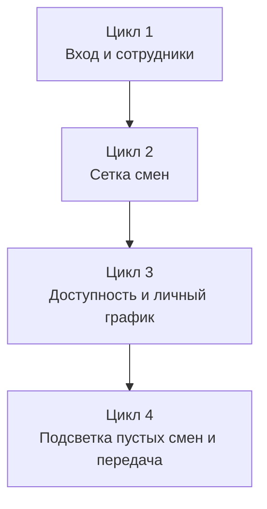

# Обоснование выбора модели разработки программного проекта

## 1. Название проекта

Смены

## 2. Краткое описание проекта

Веб-приложение для составления графика смен в небольшом кафе. Управляющий составляет график на неделю и видит смены без сотрудников. Сотрудники отмечают, когда могут работать, и смотрят свой график. Срок проекта 3 месяца, команда 4 человека.

## 3. Анализ требований

Насколько понятны требования заказчика? Общая идея понятна, но детали заказчик пока представляет примерно. Например, как должна выглядеть сетка смен и как удобнее отмечать доступность.
Может ли заказчик менять требования? Да. Скорее всего, он захочет что-то поправить, когда увидит первые экраны.
Можно ли разделить продукт на части? Да. Вход, сетка смен, отметка доступности, личный график и подсветка пустых смен могут разрабатываться по отдельности.
Нужно ли показывать промежуточные результаты? Да. Управляющий быстро проверит, удобно ли приложение, и подскажет, что исправить.
Насколько критичны сроки? Срок 3 месяца фиксированный, продлить его нельзя.

## 4. Сравнение моделей

|Модель|Как будет организована разработка|Преимущества|Недостатки|
|---|---|---|---|
|Waterfall|Сначала 3-4 недели собираем и согласуем все требования, затем проектируем всё приложение, пишем код, тестируем и передаём заказчику|Понятный план, меньше встреч с заказчиком|Заказчик увидит приложение только в конце, а правки обойдутся дорого|
|Итерационная|Делаем простую версию всего приложения и несколько раз улучшаем её по замечаниям управляющего|Ошибки находятся рано|Улучшать можно бесконечно, и команда может не уложиться в срок|
|Инкрементальная|Добавляем готовые части по очереди: вход, сетка смен, доступность, личный график, подсветка|После каждой части есть рабочий результат, удобно делить задачи|Нужно заранее продумать базу данных, иначе части трудно будет соединить|
|Agile|Работаем циклами по 3 недели. В каждом цикле планируем задачи, делаем часть функций, тестируем и показываем управляющему, затем учитываем его замечания|Можно менять требования, заказчик участвует в работе|Нужно следить, чтобы объём не разрастался, и регулярно встречаться с заказчиком|

## 5. Выбранная модель

Agile.

## 6. Обоснование выбора

На выбор повлияли три особенности проекта: заказчик может менять требования, детали интерфейса станут понятны только после показа, а срок жёстко ограничен.

Преимущества выбранного подхода:

управляющий видит результат каждые 3 недели и сразу говорит, что поправить;
изменения вносятся вовремя, а не в конце проекта;
даже если что-то не успеем, к концу срока будет рабочая версия с основными функциями.

Waterfall не подходит, потому что при нём заказчик увидел бы приложение слишком поздно, а изменения требований в проекте вероятны.

Ограничения:

объём может разрастись, если заказчик будет постоянно просить новое. Чтобы этого избежать, мы заранее зафиксировали границы проекта (без расчёта зарплаты и учёта рабочего времени), а новые идеи записываем в список на потом;
нужны регулярные встречи с заказчиком, поэтому их время согласуем заранее.

Подходы можно совмещать. Каждый цикл Agile добавляет новую часть функций (это инкремент), а между циклами мы улучшаем уже готовое (это итерации).

## 7. Предварительный план разработки

Цикл 1 (недели 1-3). Уточняем требования, создаём базу данных, делаем вход для управляющего и сотрудников. Результат: можно войти в систему и добавить сотрудников.

Цикл 2 (недели 4-6). Делаем сетку смен на неделю. Результат: управляющий назначает сотрудников на смены.

Цикл 3 (недели 7-9). Добавляем отметку доступности и личный график сотрудника. Результат: сотрудники отмечают, когда могут работать, и видят свои смены.

Цикл 4 (недели 10-12). Добавляем подсветку смен без сотрудников, исправляем ошибки, проводим итоговое тестирование и передаём приложение заказчику. Результат: готовое приложение, которое принял заказчик.

Тестирование выполняется в каждом цикле, а после каждого цикла управляющий смотрит результат и даёт замечания.
