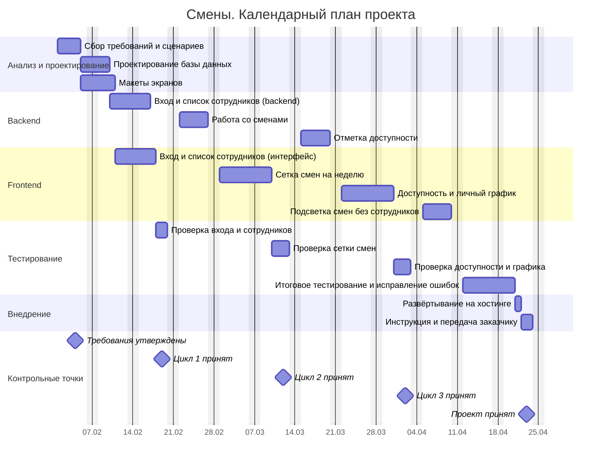

# Календарный план проекта «Смены»

Проект рассчитан на 12 недель. Разработка идёт по модели Agile, в 4 цикла по 3 недели. Даты условные, старт в понедельник 01.02.2027.

## 1. Участники

В команде 4 человека, поэтому часть ролей совмещается:

- Руководитель (он же аналитик): планирует работу, собирает требования, общается с заказчиком.
- Разработчик 1: база данных и серверная часть.
- Разработчик 2: интерфейс.
- Тестировщик: проверяет приложение и ищет ошибки.

## 2. Задачи, трудоёмкость и ответственные

В таблице указаны часы работы, а не календарные сроки.

|№|Этап|Задача|Результат|Часы|Ответственный|После задач|
|---|---|---|---|---|---|---|
|1|Анализ|Сбор требований и сценариев|Список требований и сценарии работы управляющего и сотрудника|16|Руководитель|нет|
|2|Проектирование|Проектирование базы данных|Схема базы данных|10|Разработчик 1|1|
|3|Проектирование|Макеты экранов|Макеты входа, сетки смен и личного графика|12|Разработчик 2|1|
|4|Backend|Вход и список сотрудников|Работают вход и добавление сотрудников|24|Разработчик 1|2|
|5|Frontend|Вход и список сотрудников|Готовы форма входа и список сотрудников|16|Разработчик 2|3|
|6|Тестирование|Проверка входа и сотрудников|Список найденных ошибок|6|Тестировщик|4, 5|
|7|Backend|Работа со сменами|Можно создавать смены и назначать сотрудников|20|Разработчик 1|4|
|8|Frontend|Сетка смен на неделю|Готов экран сетки смен|24|Разработчик 2|5, 7|
|9|Тестирование|Проверка сетки смен|Список найденных ошибок|8|Тестировщик|8|
|10|Backend|Отметка доступности|Сотрудник может сохранить, когда он может работать|12|Разработчик 1|7|
|11|Frontend|Доступность и личный график|Готовы экран доступности и личный график|20|Разработчик 2|8, 10|
|12|Тестирование|Проверка доступности и графика|Список найденных ошибок|8|Тестировщик|11|
|13|Frontend|Подсветка смен без сотрудников|Пустые смены выделены цветом|10|Разработчик 2|12|
|14|Тестирование|Итоговое тестирование и исправление ошибок|Приложение без критичных ошибок|20|Тестировщик и разработчики|13|
|15|Внедрение|Развёртывание на хостинге|Приложение доступно по ссылке|8|Разработчик 1|14|
|16|Внедрение|Инструкция и передача заказчику|Инструкция и принятое заказчиком приложение|8|Руководитель|15|

Всего 222 человеко-часа: руководитель 24, разработчик 1 74, разработчик 2 82, тестировщик 42. Это не значит, что команда из 4 человек закончит за 55 часов, потому что многие задачи зависят друг от друга. Остальное время уходит на встречи с заказчиком, правки по замечаниям и запас.

## 3. Зависимости

Начинать нужно с задачи 1, потому что остальные работы зависят от требований. После неё база данных (задача 2) и макеты экранов (задача 3) делаются параллельно.

Дальше порядок такой:

- Задача 4 начинается после задачи 2, а задача 5 после задачи 3. Они идут параллельно.
- Задача 6 начинается, когда готовы задачи 4 и 5.
- Задача 7 начинается после задачи 4.
- Задача 8 начинается, когда готовы задачи 5 и 7.
- Задача 9 начинается после задачи 8.
- Задача 10 начинается после задачи 7 и идёт параллельно с задачей 9.
- Задача 11 начинается, когда готовы задачи 8 и 10.
- Задача 12 начинается после задачи 11.
- Остальные задачи идут по очереди: 13 после 12, 14 после 13, 15 после 14, 16 после 15.

Тестирование каждой части начинается сразу после того, как она готова. Так ошибки находятся раньше.

## 4. Распределение по неделям

Цикл 1 (недели 1-3), результат: вход и список сотрудников.
- Неделя 1: задачи 1, 2, 3.
- Неделя 2: задачи 2, 3, 4, 5.
- Неделя 3: задачи 4, 5, 6.

Цикл 2 (недели 4-6), результат: сетка смен.
- Неделя 4: задача 7.
- Неделя 5: задача 8.
- Неделя 6: задачи 8, 9.

Цикл 3 (недели 7-9), результат: доступность и личный график.
- Неделя 7: задача 10.
- Неделя 8: задача 11.
- Неделя 9: задачи 11, 12.

Цикл 4 (недели 10-12), результат: готовое приложение у заказчика.
- Неделя 10: задача 13.
- Неделя 11: задача 14.
- Неделя 12: задачи 14, 15, 16.

## 5. Контрольные точки

1. Требования утверждены, 04.02.2027. Заказчик согласовал список требований.
2. Цикл 1 принят, 19.02.2027. Работают вход и список сотрудников.
3. Цикл 2 принят, 12.03.2027. Управляющий может составить график на неделю.
4. Цикл 3 принят, 02.04.2027. Сотрудники отмечают доступность и видят свой график.
5. Проект принят заказчиком, 23.04.2027. Приложение развёрнуто, инструкция передана.

## 6. Диаграмма Ганта

